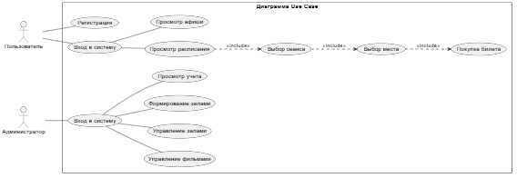
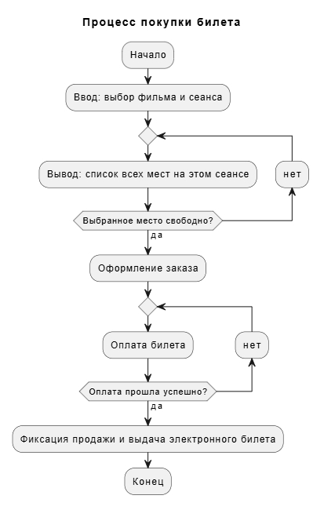
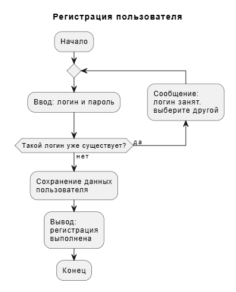

# Учет продажи билетов в кинотеатр

**Выполнил:** Хаитов Михаил  

## Описание
Проект автоматизирует продажу билетов, составление расписания и учет выручки кинотеатра в единой цифровой системе. Это ускоряет обслуживание клиентов, оптимизирует загрузку залов под текущий спрос и исключает ошибки ручного контроля.

## Цели
* Отказ от бумажного учета, обеспечение онлайн-доступности афиши и учет статистики продаж.
* Убрать очереди на кассах за счет быстрой продажи билетов.
* Исключить ошибки с местами, чтобы на одно кресло не продали два билета.

## Основные роли и функции
1. **Администратор (Сотрудник):**
   * Управление базой фильмов и залов (ряды, места).
   * Формирование расписания сеансов.
   * Контроль кассовых операций и просмотр отчетов о выручке.
2. **Пользователь (Зритель):**
   * Регистрация и вход в систему.
   * Просмотр афиши и детального расписания.
   * Интерактивный выбор мест и покупка электронного билета.
   
## Стек технологий 
* **Язык программирования:** Python 3.14
* **Среда разроботки:** VS Code 
* **Система контроля версий:** Git и GitHup

## Диаграмма Use Case
Реализовано с помощью PlantUML:

## Блок схема (1). Процесс покупки билета
Реализовано с помощью PlantUML:

## Блок схема (2). Регастрация пользователя
Реализовано с помощью PlantUML:

## ER-Диаграмма 

